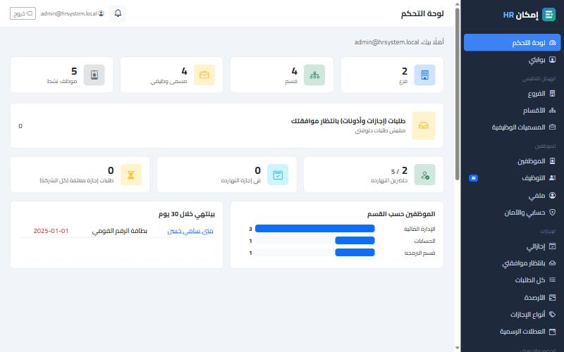
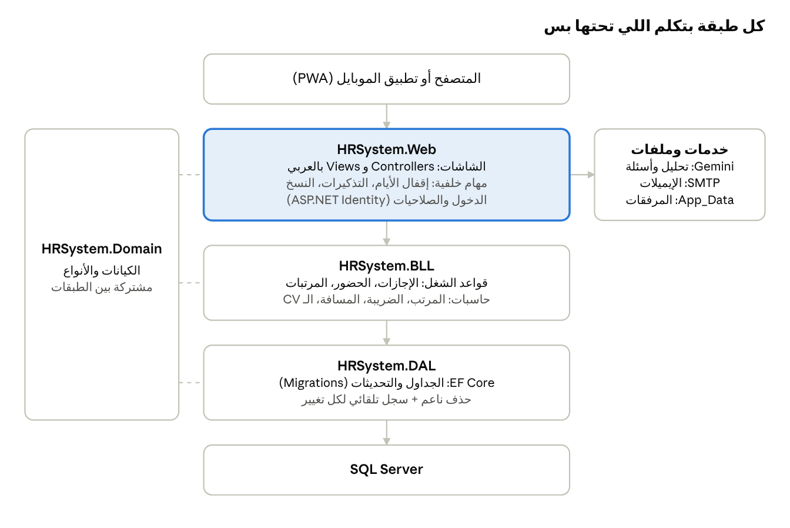
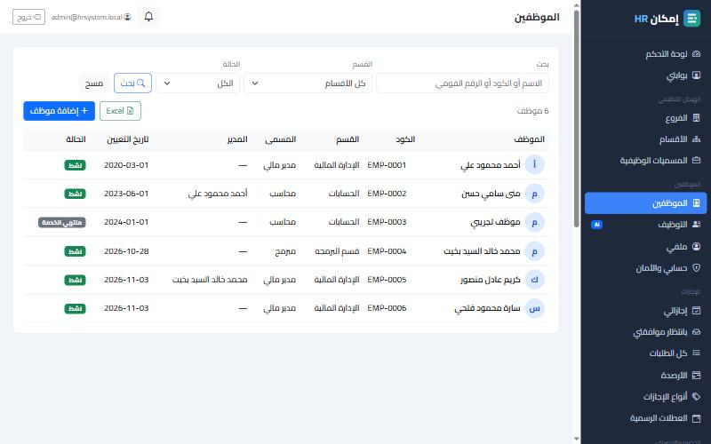
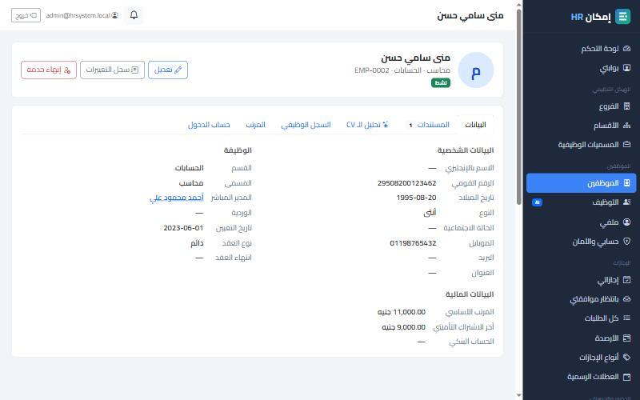
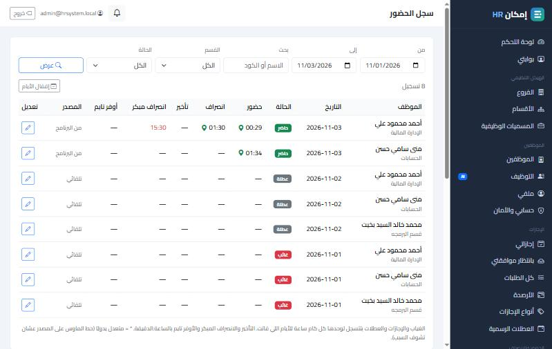
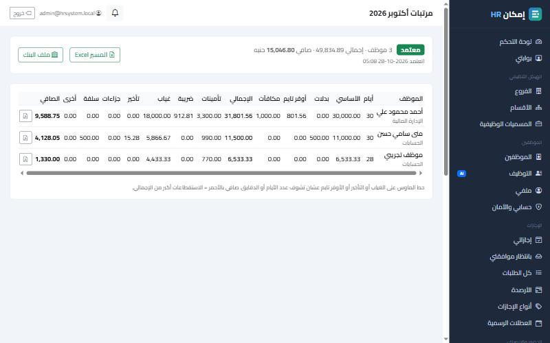
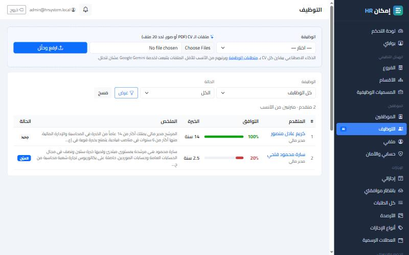
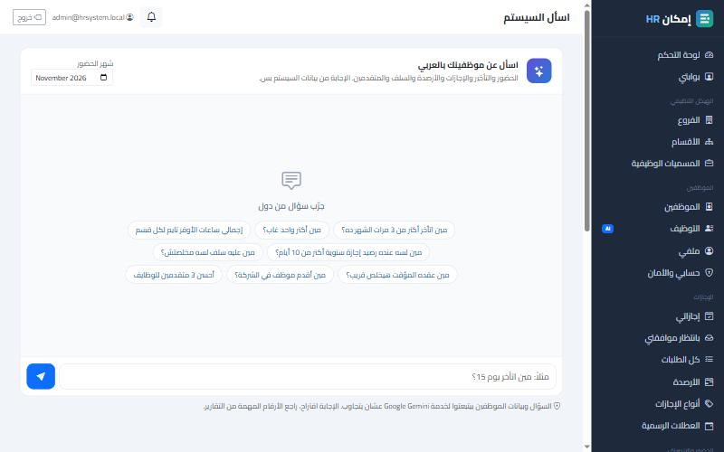
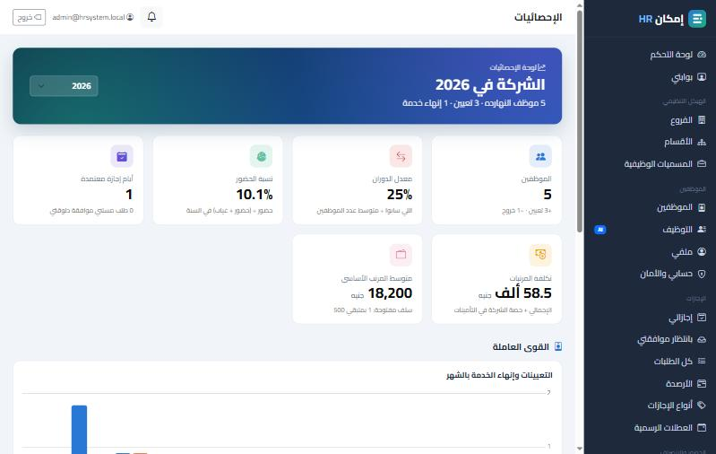
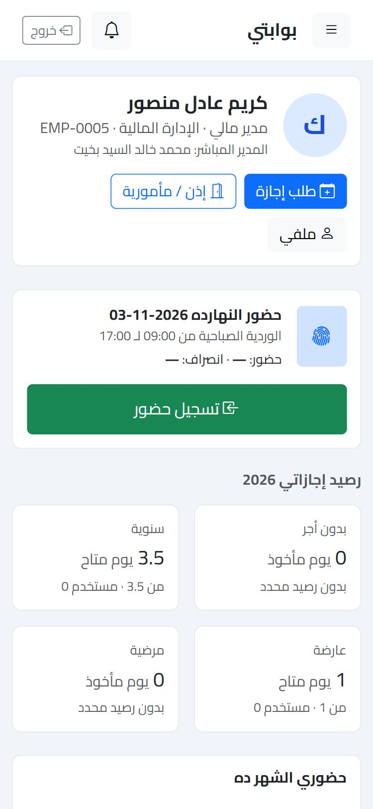

# Emkan HR — HR, Attendance & Payroll System

A complete Human Resources system built with **ASP.NET Core MVC (.NET 9)** and **SQL Server**: employees, attendance with fingerprint devices, leaves, loans, payroll and payslips, recruitment with AI CV screening, an employee self-service portal and a mobile-friendly PWA. The interface is in Arabic (RTL).

> العربي: [README.ar.md](README.ar.md)



## Features

| Area | What it does |
|---|---|
| **Organization** | Branches, departments, job titles and positions, interactive org chart |
| **Employees** | Full employee file with tabs, documents and attachments, employment records |
| **Attendance** | Shifts, public holidays, work calendar, attendance requests, location-based check-in with selfie (mobile) |
| **Fingerprint devices** | Reads ZKTeco devices directly over TCP (port 4370), plus an on-premise agent for cloud-hosted installs |
| **Leaves** | Leave types, yearly balances, requests and approvals |
| **Payroll** | Salary components, tax brackets, loans and adjustments, monthly payroll run, PDF payslips |
| **Recruitment** | Candidates pipeline with **AI CV screening** (match % and reasons against the job requirements) |
| **Ask the system** | Ask HR questions in plain language and get answers from the data (AI) |
| **Self-service portal** | Employees see their attendance, leaves, loans and payslips, and submit requests |
| **Statistics & reports** | Workforce, attendance, leave and payroll charts; Excel and PDF exports |
| **Notifications** | In-app bell, daily reminders, optional email |
| **Security** | Role-based access (Admin, HR, Manager, Employee), two-factor sign-in, password reset, full audit log |
| **Operations** | Scheduled database backups with download, background jobs, installable PWA |

## Architecture



```
HRSystem.sln
├── HRSystem.Domain            Entities, enums, constants (no dependencies)
├── HRSystem.DAL               EF Core DbContext, configurations, migrations, Repository + Unit of Work
├── HRSystem.BLL               Business services, DTOs, validation, payroll and attendance rules
├── HRSystem.Web               ASP.NET Core MVC: controllers, views, Identity, hosted services
├── HRSystem.FingerprintAgent  Small console app that reads ZKTeco devices on the company network and pushes punches to the site
└── HRSystem.Tests             xUnit tests for the business logic
```

- **N-Layer architecture** with Repository and Unit of Work over Entity Framework Core.
- **ASP.NET Core Identity** with roles and two-factor authentication.
- **Hosted services** for device sync, daily attendance closing, reminders and database backups.
- **ZKTeco protocol implemented directly** in C# (no vendor SDK or COM components).
- **AI** through the Google Gemini REST API behind an `IAiClient` interface, so the provider can be swapped.
- **QuestPDF** for payslips and reports, **ClosedXML** for Excel exports.

## Tech stack

C# · ASP.NET Core MVC 9 · Entity Framework Core · SQL Server · ASP.NET Core Identity · Hosted Services · QuestPDF · ClosedXML · xUnit · jQuery · Bootstrap (RTL) · PWA

## Screenshots

| | |
|---|---|
|  |  |
|  |  |
|  |  |
|  |  |

## Run locally

Requirements: .NET 9 SDK, SQL Server (any edition), Visual Studio 2022 or later.

1. Clone the repository and open `HRSystem/HRSystem.sln`.
2. Set your SQL Server in `HRSystem/HRSystem.Web/appsettings.json` → `ConnectionStrings:DefaultConnection`.
3. Run the `HRSystem.Web` project. The database is created and seeded on first run.
4. Sign in with the development admin account from `appsettings.Development.json`.

AI features are optional. To enable them, create `HRSystem/HRSystem.Web/appsettings.Local.json` (ignored by Git):

```json
{ "Ai": { "ApiKey": "YOUR_GEMINI_API_KEY" } }
```

Run the tests:

```bash
dotnet test HRSystem/HRSystem.sln
```

## Author

**Mohammed Khalid** — Back-End .NET Developer
[LinkedIn](https://www.linkedin.com/in/mohammed-khaled-a46856208/) · [GitHub](https://github.com/mohammedkhalid22)
